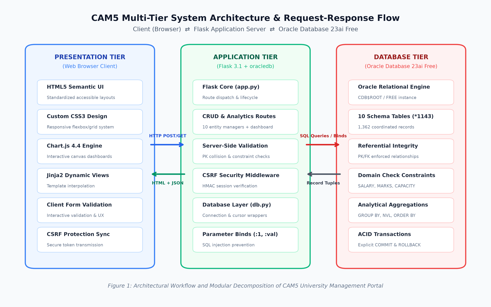
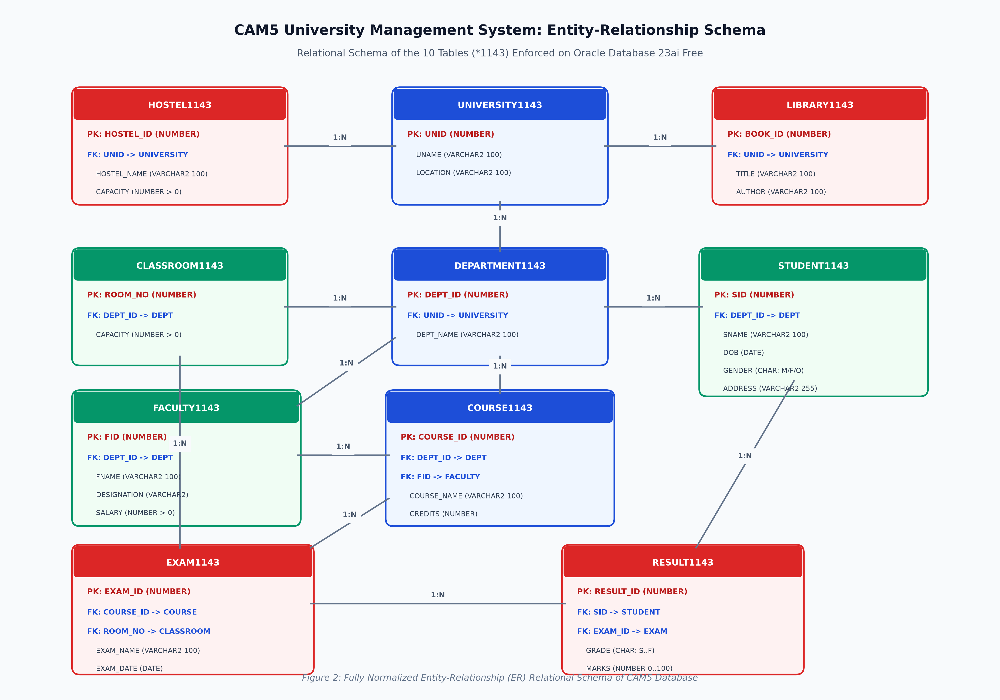

# University Management System

A multi-tier web application and relational database management system designed for higher education administration. Engineered with **Python Flask** and **Oracle Database 23ai Free** using the high-performance pure-Python `oracledb` Thin client driver, this platform provides end-to-end administration, real-time visual analytics, and strict relational integrity across ten academic entities.

---

## Architecture Overview

The system adheres to an enterprise 3-tier Model-View-Controller (MVC) architectural design pattern:

```
[ Web Browser Client ]
  │ HTML5 Semantic UI, Custom CSS3 Design System, Chart.js 4.4
  ▼ HTTP GET / POST (CSRF-Guarded)
[ Flask Application Tier ]
  │ Routing, Parameterized SQL Binding, Server Validation, Jinja2 Templates
  ▼ Oracle Net Protocol (Thin Mode)
[ Oracle Database 23ai Free ]
    CDB$ROOT / FREE PDB, Normalized Relational Tables, Constraints, ACID Transactions
```



---

## Key Features

- **Complete Multi-Entity Administration:** Comprehensive CRUD (Create, Read/Filter, Update, Delete) workflows across all 10 core academic tables:
  1. **Universities:** Campus profiles, geographic distribution, affiliated centers.
  2. **Departments:** Academic branches and collegiate affiliations.
  3. **Faculty:** Instructional staffing, academic designations, compensation registers.
  4. **Students:** Admissions, demographics, gender distribution, residential profiles.
  5. **Courses:** Curriculum catalogs, credit weightings, instructional assignments.
  6. **Classrooms:** Lecture theaters, laboratory spaces, seating capacities.
  7. **Examinations:** Scheduled midterms, end-semester evaluations, examination halls.
  8. **Results:** Academic performance evaluations, letter grades (`S` through `F`), score registers (0–100).
  9. **Library:** Textbook catalogs, reference inventories, campus allocations.
  10. **Hostels:** Residential dormitories, campus boarding facilities, bed capacities.
- **Executive Analytics Dashboard:**
  - 10 real-time KPI metric overview cards.
  - 6 interactive **Chart.js** data visualizations:
    - Departmental student enrollment breakdown.
    - Faculty and course distribution across departments.
    - Grade distribution curve (`S`, `A`, `B`, `C`, `D`, `E`, `F`).
    - Examination schedules mapped by course.
    - Departmental dispersion per university campus.
    - Campus hostel bed accommodations.
  - Physical facility benchmark cards (Classroom seats & Hostel bed utilization).
- **Relational Integrity & Defensive Validation:**
  - Enforced Primary Keys, Foreign Keys, NOT NULL constraints, and domain Check constraints (`SALARY > 0`, `MARKS BETWEEN 0 AND 100`, `CAPACITY > 0`, `GENDER IN ('M','F','O')`).
  - Next-available primary key auto-calculation (`MAX(PK) + 1`).
  - Form validation with input preservation on validation failure.
- **Enterprise Application Security:**
  - **SQL Injection Immunity:** 100% parameterized queries using Oracle bind variables (`:1`, `:param`).
  - **CSRF Defense:** Session-bound cryptographic tokens validated via constant-time comparison.
  - **Method Enforcement:** State-modifying deletion endpoints strictly reject `GET` requests with `405 Method Not Allowed`.
  - **Information Disclosure Protection:** Sanitized database exception handler to prevent leaking connection details, passwords, or TNS identifiers.

---

## Entity-Relationship Relational Schema

The underlying database consists of ten 3NF-normalized tables enforcing referential relationships and check constraints:



---

## Technology Stack

| Layer | Technology | Description |
|---|---|---|
| **Database** | Oracle Database 23ai Free | Relational engine providing ACID transactions and check constraints |
| **Driver** | python-oracledb 2.x | Official Thin-mode pure-Python driver |
| **Backend** | Python 3.10+ / Flask 3.x | Lightweight WSGI web framework and route dispatcher |
| **Templating** | Jinja2 | Server-side HTML template rendering |
| **Frontend** | Semantic HTML5 & CSS3 | Custom responsive grid/flexbox stylesheet with design tokens |
| **Visualization** | Chart.js 4.4 | Canvas-based dynamic analytics charting |
| **Testing** | unittest | Automated test harness for route availability and CSRF security |

---

## Project Structure

```
University-Management-System/
├── app.py                     # Flask route controllers & application logic
├── db.py                      # Oracle connection manager & parameterized queries
├── requirements.txt           # Core Python dependencies
├── .env.example               # Sanitized environment configuration template
├── .gitignore                 # Git ignore rules for security and clean tracking
├── LICENSE                    # Open-source license (MIT)
├── docs/                      # Architectural and schema documentation
│   └── images/
│       ├── architecture.png   # 3-tier system architecture diagram
│       └── er_diagram.png     # Normalized relational ER diagram
├── sql/                       # Database DDL schemas and seed datasets
│   ├── schema.sql             # Table creation DDL with constraints
│   ├── seed_data.sql          # Base starter dataset
│   ├── expand_student_data.sql # Student cohort expansion script
│   └── expand_university_data.sql # Full university ecosystem expansion
├── static/
│   └── css/
│       └── style.css          # Design system & responsive UI styles
├── templates/                 # Jinja2 HTML templates
│   ├── base.html              # Master layout shell & navigation
│   ├── dashboard.html         # Executive analytics dashboard
│   ├── university.html        # University directory & filters
│   ├── add_university.html    # University creation form
│   ├── departments.html       # Department directory
│   ├── add_department.html    # Department creation form
│   ├── faculty.html           # Faculty directory
│   ├── add_faculty.html       # Faculty creation form
│   ├── students.html          # Student directory & filters
│   ├── add_student.html       # Student registration form
│   ├── courses.html           # Course catalog
│   ├── add_course.html        # Course creation form
│   ├── classrooms.html        # Classroom directory
│   ├── add_classroom.html     # Classroom creation form
│   ├── examinations.html      # Examination schedule
│   ├── add_exam.html          # Examination creation form
│   ├── results.html           # Academic results directory
│   ├── add_result.html        # Result grading entry form
│   ├── library.html           # Library textbook directory
│   ├── add_library.html       # Library acquisition form
│   ├── hostel.html            # Residential hostel directory
│   └── add_hostel.html        # Hostel creation form
└── tests/                     # Automated test suites
    └── test_routes.py         # Route verification & security tests
```

---

## Installation & Setup

### 1. Prerequisites
- **Python 3.10+** installed
- **Oracle Database 23ai Free** (or Oracle Database 19c/21c) running locally or remotely

### 2. Clone the Repository
```bash
git clone https://github.com/<your-username>/<your-repo-name>.git
cd <your-repo-name>
```

### 3. Create and Activate Virtual Environment
```bash
# Windows
python -m venv venv
venv\Scripts\activate

# Linux / macOS
python3 -m venv venv
source venv/bin/activate
```

### 4. Install Dependencies
```bash
pip install -r requirements.txt
```

### 5. Configure Environment Variables
Copy the template configuration file:
```bash
# Windows (PowerShell)
Copy-Item .env.example .env

# Linux / macOS
cp .env.example .env
```

Open `.env` in your editor and configure your local Oracle database credentials:
```env
# Oracle Database Connection Configuration (Thin Mode)
DB_USER=SYSTEM
DB_PASSWORD=your_actual_oracle_password
DB_HOST=localhost
DB_PORT=1521
DB_SERVICE_NAME=FREE

# Flask Application Configuration
SECRET_KEY=generate_a_secure_random_secret_key_here
FLASK_APP=app.py
FLASK_DEBUG=False
PORT=5000
```

### 6. Initialize Database Schema and Data
Run the SQL scripts using SQL*Plus or your preferred Oracle database tool (e.g., SQL Developer, Oracle Database extension in VS Code):

```sql
-- 1. Create the relational tables and integrity constraints
@sql/schema.sql;

-- 2. Populate base starter data
@sql/seed_data.sql;

-- 3. (Optional) Populate expanded demonstration dataset
@sql/expand_university_data.sql;
@sql/expand_student_data.sql;
```

---

## Running the Application

Start the Flask development server:
```bash
python app.py
```

The web portal will be accessible at:
```
http://localhost:5000
```

Navigating to `http://localhost:5000` will automatically redirect to the executive **Dashboard** (`/dashboard`).

---

## Running Tests

Execute the automated test suite to verify route availability, CSRF protections, and method restrictions:
```bash
python -m unittest discover tests
```

Expected output:
```
.....
----------------------------------------------------------------------
Ran 5 tests in 0.45s

OK
```

---

## Security Best Practices

1. **Keep Secrets Private:** Never commit `.env` or files containing live database passwords. The `.gitignore` file is configured to exclude local environment files automatically.
2. **Oracle Thin Mode:** The application uses `python-oracledb` in Thin mode, which requires no Oracle Client libraries (Instant Client) to be installed on the application server.
3. **Session Secrets:** In a production deployment, supply a strong, cryptographically generated string for `SECRET_KEY`.

---

## License

This project is licensed under the [MIT License](LICENSE).

